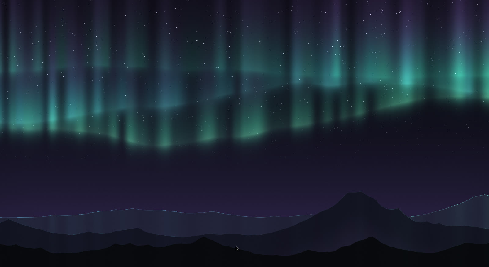

# hyprsky

Tiny animated shader wallpapers for Hyprland (and any wlroots compositor with layer-shell).
One small C program, two GPU passes, no browser, no video.

| `--scene aurora` | default (ASCII clouds) |
|---|---|
|  |  |

- **aurora**: Catppuccin Mocha aurora curtains over three ridged mountain layers, twinkling stars, film grain.
- **clouds**: black ASCII-art clouds (` .:;~)(o8`) drifting over a starfield.

## Why it's light

Measured on a 1920×1080 laptop (Intel Raptor Lake iGPU):

| | |
|---|---|
| Own memory | ~14–18 MB (plus ~50 MB of shared, file-backed Mesa driver code) |
| CPU | ~0.7–2 % |
| GPU | iGPU only, the dGPU stays asleep |

How:

- **Two passes.** The expensive part runs at low resolution: per character cell for clouds (160×68), quarter resolution for the aurora (480×270). The full-screen pass only does cheap lookups.
- **FPS cap** (15 by default). The scenes move slowly, so you can't tell the difference from 60.
- **Pauses when hidden.** Rendering is throttled by Wayland frame callbacks, so when the compositor stops showing the wallpaper (for example under a fullscreen window), it stops drawing.
- **Opaque, input-less layer surface**, so the compositor can skip blending under it.

## Recipe

### 1. Dependencies

Ubuntu / Debian:

```sh
sudo apt install build-essential pkg-config libwayland-dev libegl-dev libgles-dev wayland-protocols
```

Arch:

```sh
sudo pacman -S base-devel wayland mesa wayland-protocols
```

### 2. Build and install

```sh
git clone https://github.com/iamanishx/hyprsky
cd hyprsky
make
make install        # copies the binary to ~/.local/bin/hyprsky
```

### 3. Try it

```sh
hyprsky --scene aurora      # Ctrl+C to stop
hyprsky                     # ASCII clouds
hyprsky --fps 10            # even lighter
```

### 4. Make it your wallpaper (Hyprland)

In `~/.config/hypr/hyprland.conf`, comment out your old wallpaper (`swaybg`, `hyprpaper`, …) and add:

```ini
exec-once = env __EGL_VENDOR_LIBRARY_FILENAMES=/usr/share/glvnd/egl_vendor.d/50_mesa.json ~/.local/bin/hyprsky --scene aurora --fps 15
```

The `__EGL_VENDOR_LIBRARY_FILENAMES` part pins it to Mesa (Intel/AMD iGPU), so a hybrid-graphics laptop doesn't wake the NVIDIA card. Drop it on a desktop with a single GPU.

To restart it without logging out:

```sh
pkill -x hyprsky; hyprctl dispatch exec "~/.local/bin/hyprsky --scene aurora"
```

## Options

| Flag | Default | |
|---|---|---|
| `--scene aurora` | clouds | Pick the aurora scene |
| `--fps N` | 15 | Frame cap, 1–60 |

## Hacking

All shaders are GLSL ES 3.00 strings inside `hyprsky.c`:

- `AU_SKY` / `AU_DRAW`: aurora sky (low-res pass) and mountains, stars and grain (full-res pass). Colors are `hex(0x......)` calls, so retheming takes a minute.
- `FS_CELLS` / `FS_DRAW`: cloud density per character cell, then glyph bitmaps.

Limitation: it draws on one output (the compositor's choice); multi-monitor support isn't there yet.

`wlr-layer-shell-unstable-v1.xml` is from [wlr-protocols](https://gitlab.freedesktop.org/wlroots/wlr-protocols) and keeps its own license.

## License

MIT
